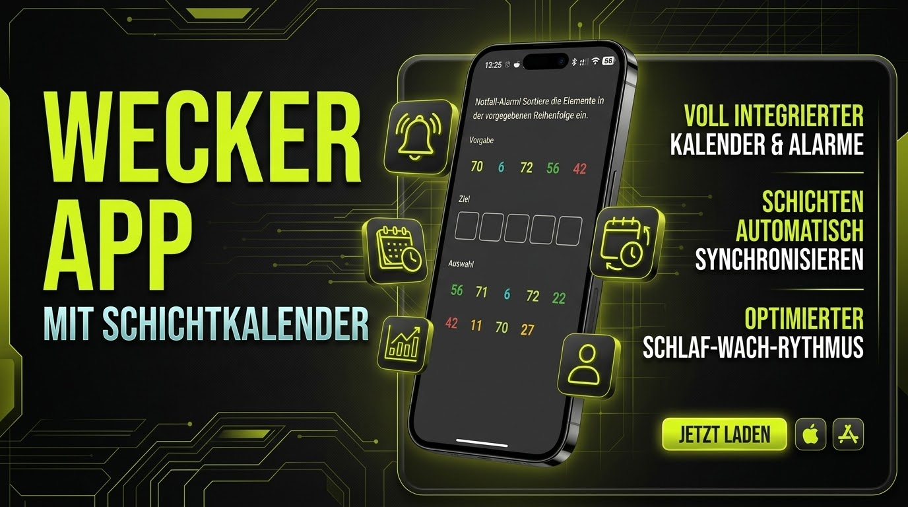
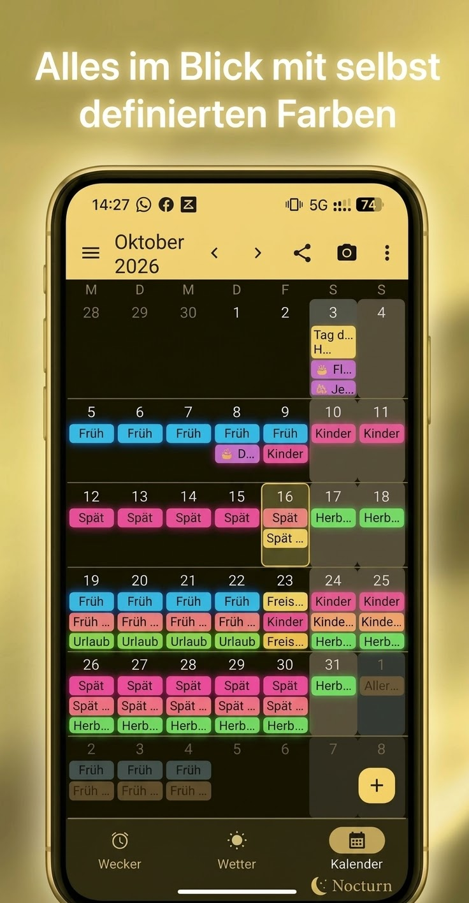

# NocTurn (Smarter Wecker)

Android-App, die es praktisch unmöglich macht, den Wecker zu verschlafen. Statt
simplem Wegdrücken wird nach dem Klingeln aktiv per Sensorik/Health Connect
überprüft, ob man tatsächlich aufgestanden ist und sich bewegt hat. Dazu ein
übersichtlicher Schichtplan-/Stundenplan-Kalender mit automatischer Rotation.

  
  

- **Entspannt den Tag genießen** – ohne Angst vor dem Verschlafen oder unnötigem
  Stress, wenn man schon wach ist: Die Aufsteh-Erkennung (Kernfunktion 1) prüft
  zuverlässig per Sensorik/Health Connect, ob wirklich aufgestanden wurde, statt
  blind einer fixen Schlummerzeit zu vertrauen.
- **Alles im Blick mit selbst definierten Farben** – der Schichtkalender zeigt
  Rotationen, manuelle Zusatzeinträge (z. B. "Kinder-Wochenende"), Feiertage und
  mehr übersichtlich nebeneinander, jede Schicht in frei wählbarer Farbe.

> **Status:** Phase 1 (MVP) ist umgesetzt und seitdem um zahlreiche Zusatzfunktionen
> erweitert (siehe unten). Details und offene Konzept-Punkte siehe
> [`CLAUDE.md`](CLAUDE.md), Umsetzungsstand siehe [`PLAN.md`](PLAN.md).

## Kernfunktionen

- **Aufsteh-Erkennung:** Health Connect (Schritte) + direkte Sensorauswertung
  (Gyroskop/Beschleunigungssensor) als Fallback ohne Smartwatch. Nach "Stop" wird
  mindestens 3,5 Sekunden anhaltende Bewegung verlangt – kurzes Aufschütteln reicht
  nicht.
- **Snooze:** Erneutes Klingeln nach zufälligem Intervall (3–5 Min), Weckton
  eskaliert/ändert sich während des Klingelns.
- **Stop ≠ fertig:** "Stop" öffnet sofort die Notfall-Aufgabe (Ton läuft nahtlos
  weiter), parallel wird bis zu 10 Minuten weiter überwacht, ob der Nutzer aufsteht
  und läuft – dann beendet sich der Notfall-Alarm automatisch, auch ohne gelöstes
  Puzzle.
- **Notfall-Alarm:** Nicht per Knopfdruck stoppbar – nur durch ein variierendes
  Drag-&-Drop-Zuordnungs-Puzzle (Geometrien, Emojis oder farbige Zahlen, Größe und
  Motiv wechseln bei jedem Auftreten).
- **Weckton-Auswahl:** Lokale Audiodateien/Systemtöne mit Vorschau, sowie als
  optionale Zusatzquelle die Lethe-Bibliothek (schmaler, widerrufbarer
  `media:read`-Scope statt vollem Messenger-Zugriff); Spotify/Deezer sind als Tabs
  vorbereitet.
- **Schichtplan-Rotation & Stundenplan:** Frei definierbare Schichten (Name + Farbe)
  je Job, Rotation als Tag-für-Tag-Muster, die die App automatisch mehrere Jahre im
  Voraus in den Kalender fortschreibt. Umschaltbarer Schüler/Student-Modus mit
  Wochenstundenplan (bis zu 12 Stunden/Tag). Konfigurierbarer Weckzeit-Abstand
  ("frühestes Wecken"/"spätestens aufstehen"). Foto-Import per On-Device-OCR
  (Tesseract4Android) mit Korrekturmöglichkeit vor der Übernahme.
- **Kalender:** Übersichtliche Monats- und Tagesansicht (Schichten, freie Termine
  mit Erinnerungen, Feiertage/Schulferien, Geburtstage aus Geräte-Kontakten),
  Swipe-Navigation zwischen Monaten, Rotations-Seitenleiste, Export als PDF/JPG/PNG,
  serverunabhängiges Teilen per ICS, Sync mit Nextcloud (CalDAV); Google Calendar
  und P2P-Kalenderfreigabe sind geplant.
- **Homescreen-Widgets:** Uhr-Widget (Uhrzeit, nächster Alarm, Wetter über
  OpenWeatherMap, nächste Termine) und Kalender-/Agenda-Widget.
- **Berechtigungen-Onboarding:** Alle benötigten Laufzeit-Berechtigungen werden
  beim ersten Start mit Begründung angefragt; Status jederzeit im 3-Punkte-Menü
  einsehbar.
- **System-Registrierung:** Meldet sich bei Android als Wecker-, Uhr- und
  Kalender-App an (`SET_ALARM`-Intents, `APP_CALENDAR`/`APP_CLOCK`-Kategorien).

## Tech-Stack

- Kotlin + Jetpack Compose + Hilt, Room als lokale Datenbank
- Health Connect API, `SensorManager` (ACC/Gyro/Step Counter) als Fallback
- `AlarmManager` (exact alarms) + Foreground Service für Klingel-/Überwachungsphase
- OkHttp + handgerollter CalDAV/ICS-Client für Nextcloud; OpenWeatherMap für Wetter;
  schulferiendaten.de für Feiertage/Schulferien; Tesseract4Android für OCR
- **minSdk 33 (Android 13)**, compileSdk/targetSdk 36 — bewusst kein Play-Store-Ziel
- FOSS-Kompatibilität als Leitlinie (offene Lizenzen bevorzugt, closed-source-Dienste
  wie Spotify/Deezer nur optionale Zusatzquellen)
- Release-Signierung + automatisches GitHub Release über GitHub Actions

Details und offene Fragen siehe [`CLAUDE.md`](CLAUDE.md), Umsetzungsstand siehe
[`PLAN.md`](PLAN.md).
